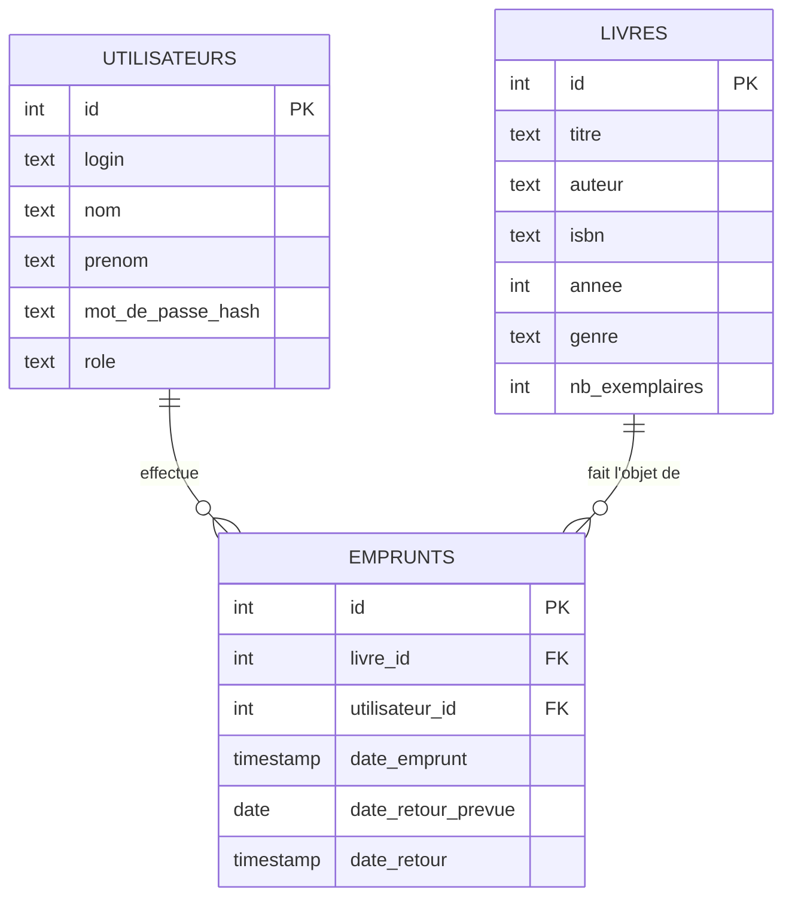

# 📚 Médiathèque — Flask + SQLite (NFP107, séquence 6)

Application Web de gestion de bibliothèque : catalogue, emprunts, retours, gestion des stocks et des utilisateurs, API JSON.

- **Application en ligne :** https://marabout.pythonanywhere.com
- **Dépôt GitHub :** https://github.com/xxxEROSxxx/Flask_Projet_SQLIte
- **Auteur :** Eros-Nathan RIGUIDEL

## 🔑 Comptes de test

| Rôle | Login | Mot de passe |
|---|---|---|
| Administrateur | `admin` | `password` |
| Utilisateur | `user` | `12345` |
| Utilisateur | `alice` | `alice123` |
| Utilisateur | `bob` | `bob123` (a un livre en retard) |

## ✅ Fonctionnalités

| # | Fonctionnalité | État |
|---|---|---|
| F1 | Enregistrer, modifier, supprimer un livre (admin) | ✅ |
| F2 | Gérer le stock (nombre d'exemplaires) | ✅ |
| F3 | Rechercher un livre (titre, auteur) + disponibilité | ✅ |
| F4 | Emprunter un livre disponible | ✅ |
| F5 | Rendre un livre | ✅ |
| F6 | Voir mes emprunts en cours (+ historique) | ✅ |
| F7 | Gérer les utilisateurs (créer, lister, supprimer) | ✅ |
| F8 | Contrôle d'accès Utilisateur / Administrateur | ✅ |
| F9 | API JSON des livres et de leur disponibilité | ✅ |

**Règles de gestion :**

| # | Règle | Comment |
|---|---|---|
| R1 | Pas d'emprunt si tous les exemplaires sont pris | disponibilité calculée, message d'erreur |
| R2 | 3 livres maximum en même temps | `COUNT` des emprunts en cours |
| R3 | Pas de suppression d'un livre en cours d'emprunt | message d'erreur |
| R4 | Pages d'administration réservées à l'admin | code `403` |
| R5 | Titre et auteur obligatoires | validation côté serveur |

**Bonus réalisés :** emprunts en retard (page admin + bandeau d'alerte pour le lecteur), statistiques (top 5 des livres, emprunts par genre), historique des emprunts, menu commun avec héritage de templates (`base.html`).

**Non réalisés :** réservation d'un livre indisponible, recommandations, API d'emprunt (`POST /api/emprunts`).

## 🗄️ Base de données



- Un emprunt **en cours** = `date_retour IS NULL`. Rendre un livre remplit `date_retour` (on garde l'historique).
- La **disponibilité** n'est pas stockée, elle est calculée : `nb_exemplaires - COUNT(emprunts en cours)`.
- Les mots de passe sont **hachés** (`werkzeug.security`). Toutes les requêtes sont **paramétrées** (`?`).
- Les clés étrangères sont activées (`PRAGMA foreign_keys = ON`).
- Structure complète : `schema.sql`. Évolutions de la base : dossier `migrations/`.

## 🧭 Routes

| Route | Méthode | Accès | Rôle |
|---|---|---|---|
| `/` | GET | tous | accueil + menu |
| `/authentification` | GET, POST | tous | connexion |
| `/deconnexion` | GET | connecté | déconnexion |
| `/livres?q=` | GET | connecté | catalogue, recherche, disponibilité |
| `/emprunter/<livre_id>` | POST | connecté | emprunter (R1, R2) |
| `/mes_emprunts` | GET | connecté | mes emprunts + historique + retards |
| `/rendre/<emprunt_id>` | POST | propriétaire ou admin | rendre un livre |
| `/admin/livres` | GET | admin | liste des livres et stocks |
| `/admin/livres/nouveau` | GET, POST | admin | ajouter un livre (R5) |
| `/admin/livres/<id>/modifier` | GET, POST | admin | modifier un livre / le stock |
| `/admin/livres/<id>/supprimer` | POST | admin | supprimer (R3) |
| `/admin/utilisateurs` | GET | admin | liste des comptes |
| `/admin/utilisateurs/nouveau` | GET, POST | admin | créer un compte |
| `/admin/utilisateurs/<id>/supprimer` | POST | admin | supprimer un compte |
| `/admin/emprunts` | GET | admin | emprunts en cours et retards |
| `/admin/stats` | GET | admin | statistiques |

## 🔌 API JSON

| Route | Réponse |
|---|---|
| `GET /api/livres` | tous les livres avec `nb_disponibles` et `disponible` |
| `GET /api/livres?q=petit` | recherche par titre ou auteur |
| `GET /api/livres/<id>` | un livre (`404` si introuvable) |
| `GET /api/clients`, `POST /api/clients`, `DELETE /api/clients/<id>` | API des ateliers (création/suppression : admin) |

## 🛠️ Installation sur le serveur

```bash
cd ~/erosnathan
python3 migrations/004_bibliotheque.py   # ajoute les tables sans effacer les données existantes
# ou, pour repartir de zéro :
python3 create_db.py
```

Déploiement continu : chaque `push` sur `main` déclenche GitHub Actions, qui envoie le code sur PythonAnywhere (la base `database.db` n'est jamais écrasée).
